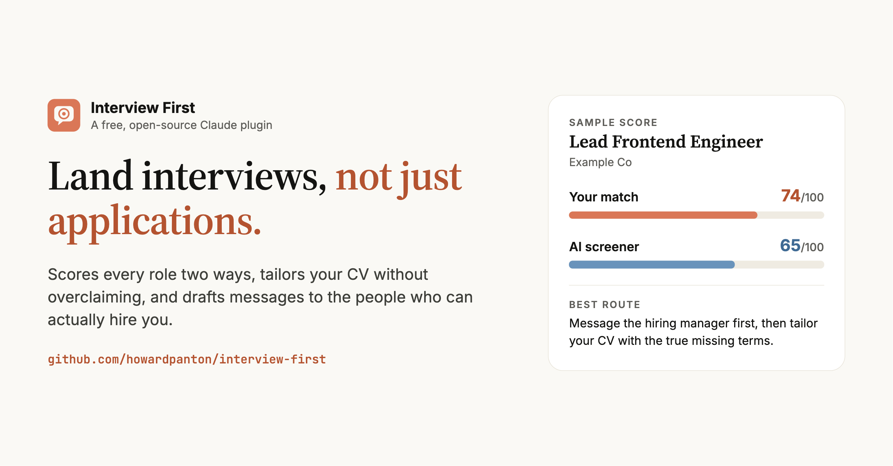

# Interview First



A Claude plugin for a job search that aims at **interviews**, not application counts.

It scores each role two ways, tailors your CV and cover letter without overclaiming, drafts
messages to the people who can actually hire you, keeps your tracker honest and prepares
you for interviews.

I built this during my own job search after redundancy in 2026, using Claude day to day.
What's here is what made a difference, with my personal details taken out.

## Why

Popular roles get hundreds of applicants within days, and software often ranks them before
a person reads anything. Sending more applications mostly adds to the pile. Three things
helped more:

- **Knowing why you'd be filtered out.** A role can be a strong match for you while your CV,
  as written, fails the screen. Those are two different problems with different fixes, so
  this kit scores them separately.
- **Reaching a person.** A short message to a hiring manager or a referral gets read by a
  human. For strong-fit roles, that's often the better route.
- **Honesty.** An AI will happily write that you've done things you haven't. That might get
  you an interview, and it will lose you the job at the interview. Every skill here works
  from your own evidence, says gaps plainly, and flags anything it isn't sure of.

## What's in it

| Skill | What it does |
| --- | --- |
| `job-search-core` | Your profile, the honesty rules and the file layout every other skill uses |
| `job-fit-score` | Two scores out of 100: your **match** to the role, and how an AI **screener** would rank your CV, with what to fix |
| `cv-tailor` | A master CV and honest tailored versions, ready to save as a screener-friendly PDF |
| `cover-letter` | One page that follows the listing's priorities, backs each claim with evidence and names gaps |
| `outreach` | Short messages to hiring managers, recruiters, referrers and contacts, plus follow-ups and thank-yous |
| `linkedin-review` | Checks your LinkedIn profile (its "Save to PDF" export) against your CV: mismatches, whether recruiters would find you, overclaims and privacy, plus a new headline and About |
| `application-tracker` | A tracker (CSV or your own spreadsheet), what's due today, and a weekly review |
| `daily-job-search` | Finds new roles, scores them and adds the best to your tracker; can run on a schedule |
| `interview-prep` | A story bank, a prep pack per role, mock interviews with feedback, and debriefs |

| Command | |
| --- | --- |
| `/interview-first:setup` | Create your profile from your CV and set up your folders |
| `/interview-first:score [link]` | Score a listing |
| `/interview-first:tailor [role]` | Tailor your CV for a role |
| `/interview-first:cover-letter [role]` | Write a cover letter |
| `/interview-first:outreach [who and why]` | Draft a message |
| `/interview-first:linkedin-review [PDF]` | Review your LinkedIn profile |
| `/interview-first:search` | Find and score new roles |
| `/interview-first:schedule [on / change / off]` | Run the search every weekday morning |
| `/interview-first:today` | What's due today |
| `/interview-first:review` | Weekly numbers and one change to make |
| `/interview-first:prep [company] [prep / mock / debrief]` | Interview preparation |

**Guides**

- [The 60-day interview plan](guides/60-day-interview-plan.md): weekly targets, outcome
  checkpoints and what to change when the numbers fall short.
- [The "true but missing" exercise](guides/cv-gaps-exercise.md): find the good evidence
  your CV leaves out.
- [How screeners read your CV](guides/how-screeners-read-your-cv.md)
- [Leaving well](guides/leaving-well.md): redundancy, notice and telling new employers.

**Templates:** a [profile](templates/profile.md), a screener-friendly
[CV](templates/cv.html) and [cover letter](templates/cover-letter.html), and a
[tracker](templates/tracker.csv). See a [sample score](examples/sample-score.md).

## Install

In Claude Code:

```
/plugin marketplace add howardpanton/interview-first
/plugin install interview-first@interview-first
```

Then, in an empty folder for your job search:

```
/interview-first:setup
```

It asks for your CV and a few questions, then creates a private `job-search/` folder with
your profile, tracker and outcomes log. The first time, Claude asks for permission to read
the plugin's own templates (profile, CV and tracker). Allow it so setup can copy them.

At the end it offers a **daily job search**: each weekday morning it finds new roles, scores
them and adds the best to your tracker, so the results are waiting when you start. You can
set this up, change it or turn it off later with `/interview-first:schedule`.

This needs a Claude setup that can run scheduled tasks. If yours can't, run
`/interview-first:search` each morning instead. Some scheduled runs happen in the cloud:
they can't reach files on your computer, and may not have this plugin installed. A tracker
in a connected spreadsheet (such as Google Sheets) works either way. Otherwise the run lists
the roles in its summary for you to add, without scores if the plugin isn't there.

**Not using Claude Code?** The skills are plain Markdown. Open a skill's `SKILL.md`, paste
it into a chat with your profile or CV, then ask for what you need. The guides and
templates work on their own.

**PDFs:** open the HTML CV or cover letter in your browser and choose **Print → Save as
PDF**, with margins left at Default and headers and footers turned off. The templates set
their own page size and margins.

## Privacy and safety

**What's stored, and where**

| What | Where | Notes |
| --- | --- | --- |
| Profile, CVs, letters, prep packs, outcomes | `job-search/` in your own folder | Excluded from git by `.gitignore`. Don't commit it to a public repository |
| Tracker | `job-search/tracker.csv`, or a spreadsheet you choose | Contacts by name and role only |
| Daily search | A scheduled task in your Claude account | Its prompt holds only titles, places, limits, pay floor and skill names |

**What the plugin does to protect you**

- It treats job listings and web pages as data, never as instructions. If a listing has
  hidden text aimed at an AI, it ignores it and tells you.
- It drafts; you send. It doesn't apply, message anyone or sign in for you.
- It never puts your personal details in search queries or URLs, or sends them anywhere
  you haven't chosen.
- It asks you to leave out what isn't needed: ID numbers, bank details, passwords, date of
  birth, home address, health information and current salary.
- It never scores or advises on age or other protected characteristics.
- It keeps confidential employer material out of anything you send.

**Deleting your data:** delete the `job-search/` folder, your tracker spreadsheet if you
used one, and the daily search (`/interview-first:schedule off`).

These safeguards reduce risk; they don't remove it. Read everything before you send it.
See [SECURITY.md](SECURITY.md) to report a problem.

## What this kit does not claim

- **The scores are estimates,** not predictions. Real screeners differ between employers
  and aren't public. The rubric is a practical model that matched one person's early
  results; check it against your own outcomes.
- **The targets in the 60-day plan are working goals,** not market statistics.
- **It can be wrong.** Check facts about companies, pay and law yourself.
- **It isn't legal or financial advice.** For redundancy terms or contracts, use your
  country's official guidance or a qualified adviser.
- **It doesn't apply or send messages for you.** You stay in charge of what goes out under
  your name.
- **It follows each site's rules.** Searches use public pages at low volume and stop when a
  site blocks automated access. Some sites, LinkedIn included, restrict automated access in
  their terms.

## Contributing

Ideas, fixes and outcome data are welcome as issues or pull requests. The most useful
contribution is evidence: which routes, CV changes and scores led to interviews for you.

Before sharing outcomes, remove the names of companies and people, and anything that could
identify you or them. Share scores, routes, role types and results only. Report security
problems privately (see [SECURITY.md](SECURITY.md)).

## Licence

MIT
